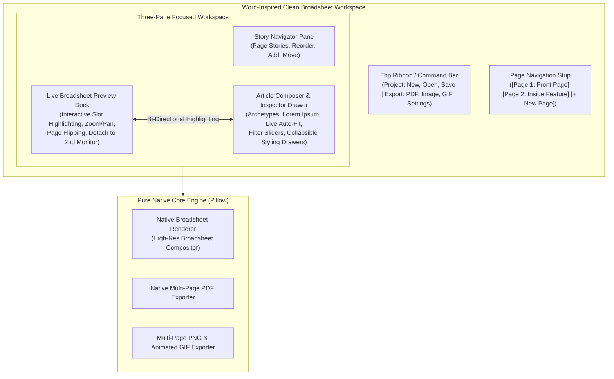

# The Daily Prophet: Modernization & Multi-Page Architecture Roadmap

This document outlines the architectural redesign, cleanup, and feature implementations for **The Daily Prophet** desktop application.

---

---

## 1. Roadmap & Implementation Checklist

### Phase 1: Foundation Cleanups, Bug Fixes & Legacy Retirement
- [x] **Delete Redundant Layout Definitions**: Remove `assets/templates/layout_definitions.json` (all templates load from `.prophettemplate` archives).
- [x] **Retire Legacy HTML Engine**: Remove `daily_prophet/template_engine.py` and unneeded `test_output.html` artifacts.
- [x] **Remove `pywebview` Dependency**: Clean up `requirements.txt` and uninstall `pywebview`, `pythonnet`, etc. from `.venv`.
- [x] **Fix Tabview Right-Border Glitch**: Eliminate the 1px right border artifact on `CTkTabview` segmented button.
- [x] **Fix Story Inspector Text Clipping**: Implement dynamic `<Configure>` auto-wrapping on story inspector and text displays.
- [x] **Remove Remaining Unicode Emote**: Replace `📐` in the layout selector bar with a clean Lucide vector icon (`layout` / `grid`).

### Phase 2: Multi-Page Data Architecture & Native Exporters
- [x] **Create `NewspaperPage` Model**: Define `NewspaperPage` dataclass (`page_id`, `page_number`, `title`, `layout_id`, `stories: List[Story]`).
- [x] **Upgrade `NewspaperEdition`**: Support multi-page list with seamless auto-migration for existing single-page `.prophet` files.
- [x] **Pure Native Multi-Page PDF Exporter**: Update `pdf_exporter.py` to compile all rendered pages directly via Pillow into a borderless 300 DPI PDF (no headless browser).
- [x] **Multi-Page Image & GIF Exporter**: Implement "Export Current Page" and "Export All Pages", with full support for animated broadsheet GIFs when moving portraits are present.

### Phase 3: Interactive Live Broadsheet Preview Dock
- [x] **Native Live Preview Canvas**: Build `BroadsheetPreviewCanvas` embedded in the main window with fast scale caching.
- [x] **Interactive Canvas Controls**: Zoom (Fit to Screen, 50%, 75%, 100%, 150%), panning, and page flip buttons (`< Prev`, `Page X of Y`, `Next >`).
- [x] **Bi-Directional Interaction**: Hover/click on sheet slot selects the corresponding story in the editor; selecting a story highlights its bounding box on the sheet.
- [x] **Dual-Monitor Pop-Out / Detach Mode**: Add detach button to float preview into a dedicated resizable window on a secondary monitor, with main window auto-expanding.

### Phase 4: Streamlined Center Composer & Archetypes
- [x] **In-Window Article Composer**: Dynamic center pane replacing modal popup with instant live re-rendering on edit (debounced 150ms).
- [x] **Wizarding Article Archetypes**: One-click archetypes (Breaking News, Rita Skeeter Gossip, Ministry Decree, Quidditch Match Report, Classified Snippet).
- [x] **Live Slot Auto-Fit Meter & Font Auto-Scaler**: Gauge indicating word count against target slot geometry with auto-scale toggle.
- [x] **Wizarding Lorem Ipsum Generator**: One-click authentic placeholder text generator for rapid prototyping.
- [x] **In-Line Image Filter Sliders**: Real-time sepia warmth, newsprint grain, and vignette controls on imported story photos.
- [x] **Collapsible Accordion Drawers**: Expandable drawers for Ornate Borders, Pull Quotes, Byline/Location, and Custom Slot Overrides.

### Phase 5: Multi-Page Editor Navigation & Wireframe Sync
- [x] **Page Ribbon Bar**: Sleek page tabs strip above workspace (`[Page 1: Front Page] [Page 2: Inside Feature] [+ New Page] [Delete Page]`).
- [x] **Per-Page Layout Selector**: Allows each page to independently choose any template (Hero Lead, 3-Column Editorial, Classifieds, etc.).
- [x] **Story Mobility Actions**: "Move to Page..." dialog/menu to transfer stories across pages seamlessly.

### Phase 6: Code Quality, OOP Polish & End-to-End Verification
- [x] **Maintain Low Cognitive Complexity**: Keep all functions under Sonar limits (complexity <= 15).
- [x] **Verify Test Suites**: Backward compatibility, bundled template protection, multi-page compilation tests.
- [x] **Full GUI Smoke Test**: Validate smooth multi-monitor detachment, zero UI flickering, and responsive layout scaling.
